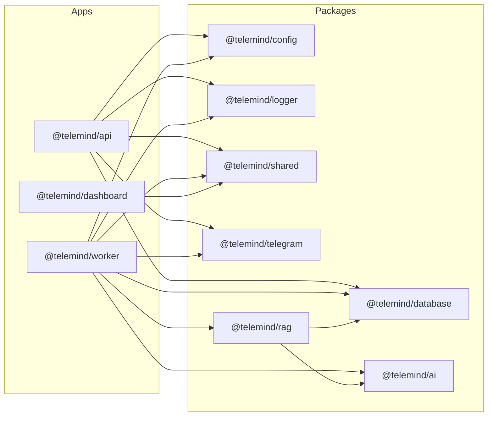
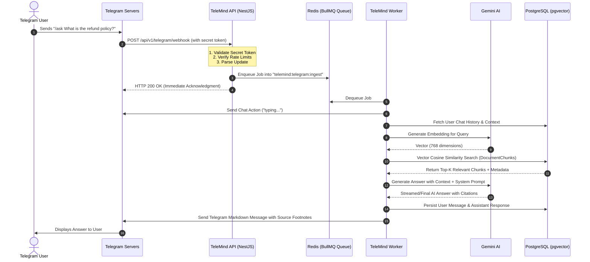
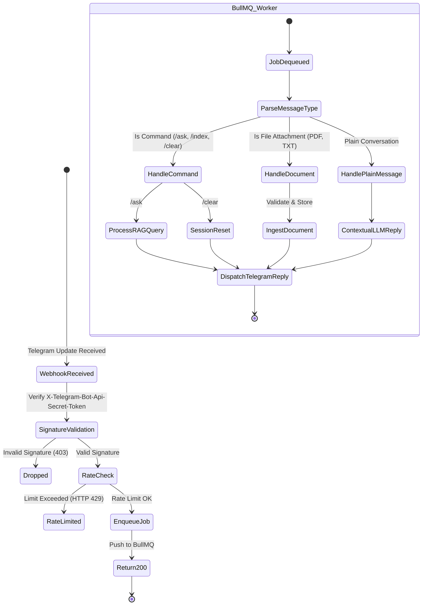
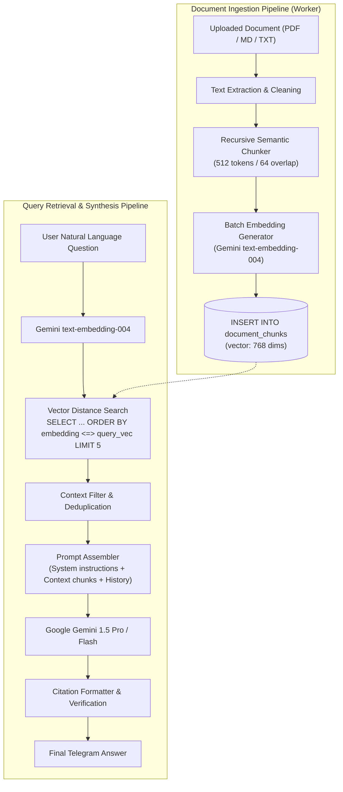
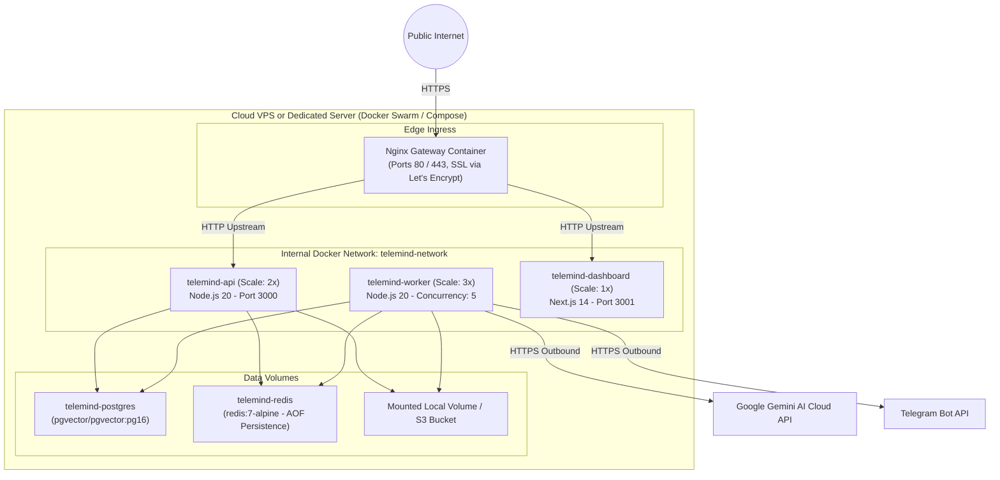

# TeleMind - Technical Architecture Specification

| **Document Version** | 1.0.0 |
| **Architectural Style** | Modular Monorepo / Decoupled Event-Driven Microservices |
| **Status** | Approved |

---

## 1. High-Level System Architecture

TeleMind is designed with a decoupled, asynchronous architecture to handle bursty Telegram messaging loads and compute-intensive Large Language Model (LLM) operations without blocking clients or incurring gateway timeouts.

```mermaid
graph TB
    subgraph Clients["External Clients & Gateways"]
        TG["Telegram Clients (Mobile / Desktop)"]
        WEB["Admin Dashboard (Browser / Next.js)"]
        TG_GW["Telegram Bot Gateway (HTTPS Webhook)"]
    end

    subgraph Ingress["Ingress & Edge Layer"]
        NGINX["Nginx Reverse Proxy / SSL Termination"]
    end

    subgraph AppCluster["TeleMind Compute Cluster"]
        API["apps/api (NestJS API Gateway)"]
        WORKER["apps/worker (NestJS BullMQ Workers)"]
    end

    subgraph StateAndQueue["State, Cache & Queue Layer"]
        REDIS[("Redis 7 (BullMQ & Cache)")]
        PG[("PostgreSQL 16 + pgvector")]
        STORAGE[("Object Storage (Local / S3)")]
    end

    subgraph ExternalAI["External AI Services"]
        GEMINI["Google Gemini API (1.5 Pro / Flash / Embeddings)"]
    end

    TG -->|Encrypted HTTPS| TG_GW
    TG_GW -->|Webhook Update| NGINX
    WEB -->|REST / HTTPS| NGINX
    NGINX -->|Reverse Proxy| API
    
    API -->|Push Task (Async)| REDIS
    API -->|Read/Write Metadata| PG
    API -->|Upload Files| STORAGE

    WORKER -->|Consume Jobs| REDIS
    WORKER -->|Vector Search & Mutations| PG
    WORKER -->|Read Files| STORAGE
    WORKER -->|Generate / Embed| GEMINI
    WORKER -->|Send Reply (HTTPS)| TG_GW
    TG_GW -->|Push Reply| TG
```

---

## 2. Component Decomposition



### Component Roles & Responsibilities

| Component | Technology | Responsibility |
|---|---|---|
| `apps/api` | NestJS, Express, Passport | Webhook receiver, REST API endpoints, JWT authentication, rate limiting. |
| `apps/worker` | NestJS, BullMQ | Asynchronous job processors for message processing, RAG indexing, AI querying. |
| `apps/dashboard` | Next.js 14, Tailwind CSS | Admin interface for knowledge base management, user administration, and system metrics. |
| `packages/database` | Prisma ORM, PostgreSQL | Unified database access layer, schema definitions, migrations, and vector types. |
| `packages/ai` | Google GenAI SDK | Client wrapper for Gemini 1.5 Pro, Flash, and `text-embedding-004`. |
| `packages/telegram` | Telegraf | Telegram Bot API client, command dispatchers, keyboard builders, and webhook validator. |
| `packages/rag` | TypeScript, pdf-parse | Ingestion, recursive chunking, embedding generation, vector similarity search, and context assembly. |
| `packages/shared` | TypeScript, Zod | Shared interfaces, DTOs, API contracts, errors, and validation schemas. |
| `packages/config` | Zod, dotenv | Validated environment configuration loaded once at process startup. |
| `packages/logger` | Pino | Structured JSON logging with trace context and redaction. |

---

## 3. Request Flow (Telegram Ingress to Async Reply)

The primary requirement is to acknowledge Telegram webhooks within **200 milliseconds** to avoid Telegram retrying and duplicating messages. All processing is handed off to BullMQ.



---

## 4. Telegram Message Flow & State Machine



---

## 5. AI & RAG Pipeline Architecture



---

## 6. Deployment Architecture


