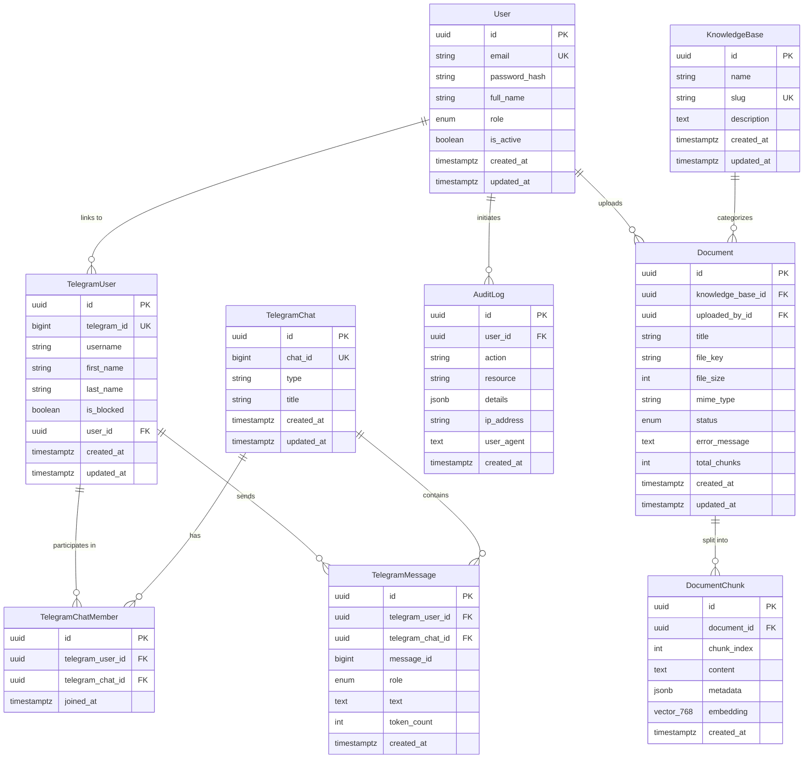

# TeleMind - Database Architecture & Schema Specification

| **Document Version** | 1.0.0 |
| **Database Engine** | PostgreSQL 16 |
| **Extensions** | `vector` (pgvector), `uuid-ossp`, `pg_trgm` |
| **ORM / Migration Tool** | Prisma ORM |

---

## 1. Overview & Core Philosophy

TeleMind stores application state, user identities, Telegram chat history, document catalogs, and high-dimensional semantic vector embeddings within a unified PostgreSQL 16 cluster. By utilizing the official **`pgvector`** extension, TeleMind eliminates the need for a separate specialized vector database (such as Pinecone, Milvus, or Qdrant) at low-to-medium scale, drastically simplifying transaction consistency, backup management, and operational overhead.

---

## 2. Entity-Relationship (ER) Diagram



---

## 3. Data Dictionary & Table Definitions

### 3.1 `users`
Stores web dashboard operators, system administrators, and registered API consumers.

| Column | Type | Constraints | Description |
|---|---|---|---|
| `id` | `UUID` | PK, Default `uuid_generate_v4()` | Primary system surrogate key. |
| `email` | `VARCHAR(255)` | UNIQUE, NOT NULL | User email address. |
| `password_hash` | `VARCHAR(255)` | NOT NULL | Salted bcrypt password hash. |
| `full_name` | `VARCHAR(255)` | NULLABLE | Display name. |
| `role` | `ENUM` | Default `'MEMBER'` | `SUPER_ADMIN`, `ADMIN`, `MEMBER`, `VIEWER`. |
| `is_active` | `BOOLEAN` | Default `TRUE` | Soft account deactivation flag. |
| `created_at` | `TIMESTAMPTZ(6)` | Default `NOW()` | Timestamp of record creation. |
| `updated_at` | `TIMESTAMPTZ(6)` | AUTO UPDATE | Timestamp of last modification. |

---

### 3.2 `telegram_users`
Maps Telegram accounts to internal database entities.

| Column | Type | Constraints | Description |
|---|---|---|---|
| `id` | `UUID` | PK, Default `uuid_generate_v4()` | Internal user ID. |
| `telegram_id` | `BIGINT` | UNIQUE, NOT NULL | Raw 64-bit Telegram user ID from API. |
| `username` | `VARCHAR(255)` | NULLABLE | Telegram handle (e.g. `@johndoe`). |
| `first_name` | `VARCHAR(255)` | NULLABLE | User's Telegram first name. |
| `last_name` | `VARCHAR(255)` | NULLABLE | User's Telegram last name. |
| `is_blocked` | `BOOLEAN` | Default `FALSE` | Manual administrative block. |
| `user_id` | `UUID` | FK -> `users(id)`, NULLABLE | Linked dashboard user if authenticated. |
| `created_at` | `TIMESTAMPTZ(6)` | Default `NOW()` | First contact timestamp. |
| `updated_at` | `TIMESTAMPTZ(6)` | AUTO UPDATE | Last update timestamp. |

---

### 3.3 `telegram_chats` & `telegram_messages`
Stores conversation sessions and audit trails for context augmentation.

- `telegram_messages` records role (`USER`, `ASSISTANT`, `SYSTEM`), textual content, and token counts.
- Indexed on `(telegram_chat_id, created_at DESC)` for high-speed recent message history retrieval.

---

### 3.4 `documents`
Catalog of ingested knowledge documents.

| Column | Type | Constraints | Description |
|---|---|---|---|
| `id` | `UUID` | PK | Document primary key. |
| `knowledge_base_id` | `UUID` | FK -> `knowledge_bases(id)` | Associated knowledge domain. |
| `uploaded_by_id` | `UUID` | FK -> `users(id)` | Uploader ID. |
| `title` | `VARCHAR(255)` | NOT NULL | Document title / filename. |
| `file_key` | `VARCHAR(512)` | NOT NULL | Object storage path or key. |
| `file_size` | `INTEGER` | NOT NULL | File size in bytes. |
| `mime_type` | `VARCHAR(100)` | NOT NULL | e.g. `application/pdf`, `text/markdown`. |
| `status` | `ENUM` | Default `'PENDING'` | `PENDING`, `PROCESSING`, `INDEXED`, `FAILED`. |
| `error_message` | `TEXT` | NULLABLE | Processing failure reason if any. |
| `total_chunks` | `INTEGER` | Default `0` | Number of chunks generated. |

---

### 3.5 `document_chunks` (Vector Storage)
Holds chunked text content, rich metadata, and 768-dimensional float embeddings generated by Gemini `text-embedding-004`.

```sql
CREATE TABLE document_chunks (
    id UUID PRIMARY KEY DEFAULT uuid_generate_v4(),
    document_id UUID NOT NULL REFERENCES documents(id) ON DELETE CASCADE,
    chunk_index INT NOT NULL,
    content TEXT NOT NULL,
    metadata JSONB NOT NULL DEFAULT '{}'::jsonb,
    embedding vector(768),
    created_at TIMESTAMPTZ(6) NOT NULL DEFAULT NOW()
);
```

---

## 4. Vector Search Indexing Strategy (`pgvector`)

### 4.1 Index Types & Tradeoffs

1. **HNSW (Hierarchical Navigable Small World)**:
   - *Best for*: High-throughput, sub-millisecond retrieval with high recall.
   - *Memory cost*: Higher index build memory footprint.
   - *Index Definition*:
     ```sql
     CREATE INDEX idx_document_chunks_embedding_hnsw 
     ON document_chunks 
     USING hnsw (embedding vector_cosine_ops)
     WITH (m = 16, ef_construction = 64);
     ```

2. **IVFFlat (Inverted File with Flat Compression)**:
   - *Best for*: Smaller memory footprints. Requires building lists after data is populated.
   - *Index Definition*:
     ```sql
     CREATE INDEX idx_document_chunks_embedding_ivfflat 
     ON document_chunks 
     USING ivfflat (embedding vector_cosine_ops)
     WITH (lists = 100);
     ```

*Default Selection for TeleMind*: **HNSW with `vector_cosine_ops`** for fast query execution under concurrent traffic.

### 4.2 Similarity Search Query Example

```sql
SELECT 
    dc.id,
    dc.document_id,
    dc.chunk_index,
    dc.content,
    dc.metadata,
    1 - (dc.embedding <=> $1::vector) AS similarity_score
FROM document_chunks dc
JOIN documents d ON d.id = dc.document_id
WHERE d.status = 'INDEXED'
  AND ($2::uuid IS NULL OR d.knowledge_base_id = $2::uuid)
ORDER BY dc.embedding <=> $1::vector
LIMIT 5;
```

---

## 5. Performance Optimization & Migration Guidelines

1. **Connection Pooling**: Use Prisma client with capped pool sizes (20-30 connections per API instance).
2. **Batch Ingestion**: Chunks should be inserted in batches of 100 to avoid long transaction locks.
3. **Vacuum & Analyze**: Periodically run `VACUUM ANALYZE document_chunks;` to update planner statistics.
