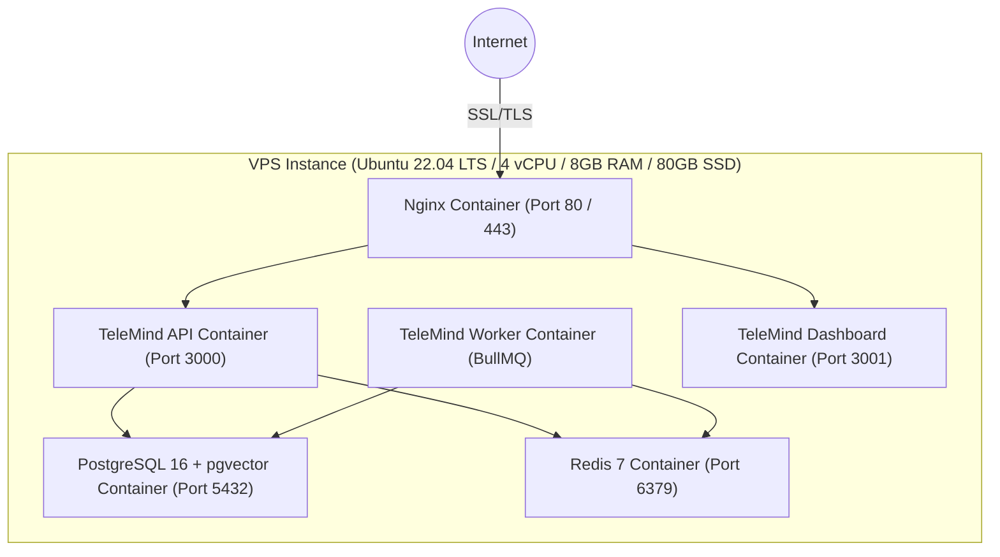

# TeleMind - Deployment & Infrastructure Guide

| **Document Version** | 1.0.0 |
| **Target Infrastructure** | Linux VPS / Dedicated Server / Docker Swarm / Kubernetes |
| **Status** | Approved |

---

## 1. Deployment Topology

TeleMind is designed to run as containerized microservices managed via **Docker Compose** for small-to-medium deployments or Kubernetes for high-availability enterprise clusters.



---

## 2. Docker & Multi-Stage Builds

All application components (`apps/api`, `apps/worker`, `apps/dashboard`) utilize hardened multi-stage Dockerfiles:
- **Base**: `node:20-alpine` with `corepack` and `pnpm`.
- **Dependencies**: Cache-mounted `pnpm install --frozen-lockfile`.
- **Builder**: TypeScript compilation, Prisma client generation, and Next.js standalone optimization.
- **Production Runner**: Minimal image running under a dedicated non-root `telemind` system user (`UID 1001`).

---

## 3. Quick Start Deployment via Docker Compose

### 3.1 Provisioning the VPS
Recommended baseline specification:
- **OS**: Ubuntu 22.04 LTS or Debian 12
- **CPU**: 4 vCPU
- **RAM**: 8 GB (PostgreSQL HNSW indexes and Node.js buffers)
- **Disk**: 80 GB SSD

### 3.2 Deployment Commands
```bash
# 1. Clone repository
git clone https://github.com/telemind/telemind.git /opt/telemind
cd /opt/telemind

# 2. Configure production environment
cp .env.example .env
nano .env # Set strong passwords, API keys, and domain names

# 3. Build and launch infrastructure & services
docker compose up -d --build

# 4. Check service status
docker compose ps
docker compose logs -f api worker
```

---

## 4. Reverse Proxy & SSL Configuration (Nginx)

The reverse proxy handles TLS termination, rate limiting, and HTTP request routing.

### 4.1 SSL Certificate Generation via Certbot
```bash
sudo apt-get install -y certbot python3-certbot-nginx
sudo certbot certonly --standalone -d telemind.example.com -d api.telemind.example.com
```

### 4.2 Nginx Host Binding
The Nginx configuration defined in `docker/nginx.conf` proxies incoming traffic:
- `api.telemind.example.com` -> `http://127.0.0.1:3000` (API Gateway)
- `telemind.example.com` -> `http://127.0.0.1:3001` (Admin Dashboard)

---

## 5. Setting up the Telegram Webhook

Once DNS and SSL are configured, register the webhook with Telegram:

```bash
curl -X POST "https://api.telegram.org/bot<TELEGRAM_BOT_TOKEN>/setWebhook" \
  -H "Content-Type: application/json" \
  -d '{
    "url": "https://api.telemind.example.com/api/v1/telegram/webhook",
    "secret_token": "<TELEGRAM_WEBHOOK_SECRET>",
    "max_connections": 40,
    "allowed_updates": ["message", "callback_query", "inline_query"]
  }'
```

Verify webhook status:
```bash
curl -s "https://api.telegram.org/bot<TELEGRAM_BOT_TOKEN>/getWebhookInfo" | jq
```

---

## 6. Continuous Integration & Continuous Deployment (CI/CD)

The GitHub Actions pipeline (`.github/workflows/ci.yml`) automates verification on every push:
1. **Lint & Formatting**: Prettier, ESLint check.
2. **Type Checking**: Full monorepo TypeScript verification.
3. **Database Spin-up**: Testcontainers / service containers running `pgvector/pgvector:pg16` and `redis:7-alpine`.
4. **Automated Testing**: Jest unit tests and integration tests with coverage reporting.
5. **CD (Optional Staging Trigger)**: On merge to `main`, Docker images are built and pushed to GitHub Container Registry (`ghcr.io`). A SSH webhook or runner triggers zero-downtime rolling restart on the VPS.

---

## 7. Disaster Recovery & Database Backups

Automated cron script for daily PostgreSQL and vector index backup:

```bash
#!/usr/bin/env bash
# /opt/telemind/scripts/backup-db.sh
set -euo pipefail
BACKUP_DIR="/var/backups/telemind"
TIMESTAMP=$(date +"%Y%m%d_%H%M%S")
mkdir -p "$BACKUP_DIR"

docker exec telemind-postgres pg_dump -U telemind_admin telemind | gzip > "${BACKUP_DIR}/telemind_${TIMESTAMP}.sql.gz"

# Retain last 14 days of backups
find "$BACKUP_DIR" -type f -name "*.sql.gz" -mtime +14 -delete
```
