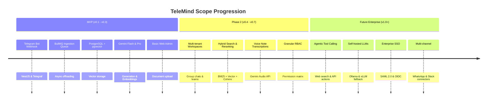

# TeleMind - Product Requirements Document (PRD)

| **Document Version** | 1.0.0 |
| **Status** | Approved |
| **Author** | Senior Staff Software Engineer & Solution Architect |
| **Target Release** | Q1 2027 |

---

## 1. Vision & Executive Summary

**TeleMind** is an enterprise-ready, AI-powered knowledge assistant accessible directly through Telegram. TeleMind bridges the gap between disorganized enterprise/personal document repositories and the instant, frictionless convenience of messaging. By leveraging state-of-the-art Large Language Models (Google Gemini 1.5 Pro and Flash) combined with PostgreSQL (`pgvector`) for semantic vector search, TeleMind enables users and teams to ingest files, query domain knowledge in natural language, summarize complex documents, and automate repetitive knowledge workflows within their Telegram chat interface or a web administration dashboard.

---

## 2. Problem Statement

1. **Information Fragmentation**: Teams and professionals store critical manuals, research papers, notes, spreadsheets, and policies across disparate drives and wikis. Finding accurate information quickly is tedious.
2. **Context Switching Friction**: Traditional knowledge management software requires users to leave communication channels, open desktop apps or browser tabs, and master complex search syntax.
3. **Accuracy and Hallucination Risks**: Standard off-the-shelf generative AI bots lack private domain context and frequently hallucinate answers without source attribution.
4. **Scale & Rate Limiting Constraints**: Direct synchronous integration of messaging bots with generative LLMs results in dropped webhooks, timeouts, rate limit bans, and terrible user experience under high traffic.

---

## 3. Goals & Objectives

### 3.1 Business Goals

- Deliver an always-available knowledge assistant directly inside Telegram for frictionless mobile access.
- Enable instant enterprise knowledge retrieval with strict source citations.
- Ensure strict multi-tenant data isolation and privacy.
- Support horizontal scaling with decoupled asynchronous job processing.

### 3.2 Technical Goals

- Keep average Telegram query response latency under 3.5 seconds for RAG queries.
- Ensure 99.95% API uptime with sub-200ms Telegram webhook ingestion via BullMQ queues.
- Support documents up to 50MB across PDF, DOCX, Markdown, and TXT formats.
- Maintain test coverage above 85% across all core packages.

---

## 4. Target Users & Personas

| Persona                           | Description                                                                          | Primary Needs                                                        |
| --------------------------------- | ------------------------------------------------------------------------------------ | -------------------------------------------------------------------- |
| **Knowledge Worker / Researcher** | Accesses scientific papers, technical specs, and project briefs on mobile on the go. | Fast answers, accurate citations, PDF summarization.                 |
| **Field Support / Operations**    | Engineers in the field requiring instant equipment manuals and operating procedures. | Telegram-native querying, zero setup, offline-capable responses.     |
| **Team Administrator**            | Manages organizational documentation, assigns member access, and audits security.    | Web dashboard, role-based access control, file lifecycle management. |

---

## 5. Feature Requirements

### 5.1 Core Features (Functional)

#### 5.1.1 Telegram Assistant Interface

- **Commands**:
  - `/start` - Initial onboarding, user registration, and tutorial.
  - `/ask <question>` - Natural language query against indexed knowledge.
  - `/index` - Prompt user to upload document for ingestion.
  - `/kb` - Select active Knowledge Base context.
  - `/stats` - View personal token and usage metrics.
  - `/clear` - Reset current conversational session memory.
  - `/help` - Command reference and documentation.
- **Document Ingestion via Chat**: Direct drag-and-drop file upload into Telegram chat. Bot automatically acknowledges receipt and provides live progress updates via message editing.
- **Source Citation**: Every AI response generated from indexed documents must include footnote citations referencing document title, section, and page/chunk index.

#### 5.1.2 Retrieval-Augmented Generation (RAG) Engine

- **Multi-Format Ingestion**: PDF, Markdown, Plain Text, and DOCX.
- **Recursive Semantic Chunking**: Chunk size target of 512 tokens with 64-token overlap, preserving semantic sentence boundaries.
- **Vector Embedding**: Integration with Google Gemini `text-embedding-004` (768 dimensions).
- **Hybrid Retrieval**: Combination of PostgreSQL full-text search (`tsvector` / `pg_trgm`) and vector cosine distance (`<=>`).
- **Context Window Management**: Dynamic ranking and prompt assembly to prevent context window overflow.

#### 5.1.3 Administration Dashboard (Web)

- Modern Next.js interface for workspace administrators.
- Document repository manager: upload, re-index, delete, and inspect chunk embeddings.
- User management: assign roles (`SUPER_ADMIN`, `ADMIN`, `MEMBER`, `VIEWER`).
- Analytics: Total queries, average response latency, token consumption, and error rates.

---

## 6. MVP Scope vs. Future Scope

---

## 7. Non-Functional Requirements (NFRs)

- **Performance**: Ingress webhook acknowledgement within 250ms.
- **Reliability**: Zero message loss through Redis-backed BullMQ persistence with automatic retries and Dead Letter Queue (DLQ).
- **Scalability**: Horizontal auto-scaling of stateless NestJS API and Worker containers.
- **Security**: AES-256 at rest, TLS 1.3 in transit, strict parameterized SQL via Prisma, and JWT authorization for REST APIs.
- **Compliance**: GDPR-compliant data erasure (`/forget-me` command and document hard delete).

---

## 8. Success Metrics (KPIs)

1. **Query Accuracy & Hallucination Rate**: Hallucination rate < 3% based on automated ground-truth evaluation datasets.
2. **First-Response Latency**: 95th percentile under 4 seconds from user message dispatch to Telegram reply.
3. **Queue Ingestion Reliability**: 99.99% successful delivery of Telegram updates into BullMQ.
4. **User Engagement**: 70%+ weekly active users (WAU) asking at least 5 queries per week.
