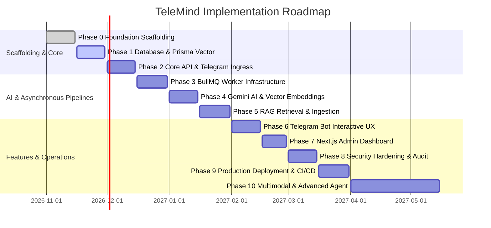

# TeleMind - Product & Engineering Roadmap

| **Version** | 1.0.0 |
| **Horizon** | Q1 2026 – Q4 2027 |
| **Status** | Active Planning |

---

## Roadmap Overview

---

## Detailed Milestones

### Phase 0: Project Inception & Foundation Scaffolding
- **Estimated Timeline**: Weeks 1–2 (November 2026)
- **Objectives**:
  - Establish monorepo structure with `pnpm-workspace.yaml`.
  - Author enterprise-level documentation (`docs/`).
  - Configure root and package configurations (`tsconfig`, ESLint, Prettier, `.gitignore`).
  - Scaffolding of all apps (`api`, `worker`, `dashboard`) and packages (`ai`, `rag`, `telegram`, `database`, `shared`, `config`, `logger`).
  - Container compose setup with PostgreSQL + pgvector and Redis.
- **Exit Criteria**: All packages build with zero type errors; containers spin up cleanly with health checks passing.

---

### Phase 1: Database Architecture & pgvector Integration
- **Estimated Timeline**: Weeks 3–4 (November 2026)
- **Objectives**:
  - Finalize Prisma schema with `postgresqlExtensions` preview feature.
  - Implement migration scripts for `vector`, `uuid-ossp`, and `pg_trgm`.
  - Create database seeding scripts with sample knowledge bases.
  - Establish connection pooling and Prisma service with lifecycle hooks in `@telemind/database`.
- **Exit Criteria**: Clean migration applied to local and test containers; vector column queries executed successfully.

---

### Phase 2: Core API Gateway & Telegram Ingress
- **Estimated Timeline**: Weeks 5–6 (December 2026)
- **Objectives**:
  - Implement NestJS Fastify/Express core modules in `apps/api`.
  - Integrate `@telemind/config` with Zod runtime validation.
  - Implement Telegram Webhook controller with secret token verification.
  - Set up authentication module (JWT access + refresh tokens, bcrypt hashing).
  - Add Swagger OpenAPI documentation auto-generation.
- **Exit Criteria**: Webhook endpoint responds with `200 OK` within 100ms; JWT login and protected endpoints functional.

---

### Phase 3: BullMQ Worker & Distributed Queue Infrastructure
- **Estimated Timeline**: Weeks 7–8 (December 2026)
- **Objectives**:
  - Configure BullMQ connection with Redis in `apps/worker`.
  - Define queues: `telemind:telegram:ingest`, `telemind:rag:indexing`, `telemind:ai:generate`.
  - Implement automatic job retries with exponential backoff and Dead Letter Queue (DLQ).
  - Add Bull-Board dashboard for queue telemetry and monitoring.
- **Exit Criteria**: Messages enqueued by API gateway are reliably consumed by Worker without drop under load tests.

---

### Phase 4: Google Gemini AI Integration Layer
- **Estimated Timeline**: Weeks 9–10 (January 2027)
- **Objectives**:
  - Implement Gemini client wrapper in `packages/ai` using `@google/genai`.
  - Build text generation pipeline with Gemini 1.5 Pro and Gemini 1.5 Flash.
  - Implement vector embedding generation pipeline using `text-embedding-004` (768 dimensions).
  - Implement retry handling for HTTP 429 rate limits and token usage telemetry.
- **Exit Criteria**: 100% test coverage on AI client; successful embedding generation and text generation mock tests.

---

### Phase 5: RAG Ingestion & Vector Retrieval Pipeline
- **Estimated Timeline**: Weeks 11–12 (January 2027)
- **Objectives**:
  - Build document parser (PDF, Markdown, TXT) in `packages/rag`.
  - Implement recursive semantic text chunker (512 tokens with 64 token overlap).
  - Implement vector similarity query using PostgreSQL `<=>` cosine distance.
  - Implement context assembly with source attribution and hallucination guardrails.
- **Exit Criteria**: End-to-end test ingesting a 20-page PDF and answering questions with accurate citations.

---

### Phase 6: Telegram Bot Interactive UX & Commands
- **Estimated Timeline**: Weeks 13–14 (February 2027)
- **Objectives**:
  - Build command handlers in `packages/telegram` (`/start`, `/ask`, `/index`, `/kb`, `/clear`, `/help`).
  - Implement dynamic message editing for progress indication ("Reading...", "Searching...", "Thinking...").
  - Support direct document attachments dropped into chat.
  - Implement inline button pagination for search results and citations.
- **Exit Criteria**: Telegram bot responds smoothly in real-time with formatted markdown and inline buttons.

---

### Phase 7: Web Administration Dashboard
- **Estimated Timeline**: Weeks 15–16 (February 2027)
- **Objectives**:
  - Develop Next.js 14 App Router UI in `apps/dashboard`.
  - Implement Knowledge Base view: upload files, view chunk breakdown, re-index.
  - Add User & Role management interface.
  - Add analytics dashboard: token count, query volume, active chats.
- **Exit Criteria**: Admins can upload documents via web and immediately query them via Telegram.

---

### Phase 8: Enterprise Security Hardening & Audit
- **Estimated Timeline**: Weeks 17–18 (March 2027)
- **Objectives**:
  - Implement granular RBAC guards across REST APIs.
  - Configure Helmet, CORS policies, and NestJS Throttler rate limiting.
  - Implement structured audit logging for all document modifications and queries.
  - Conduct static application security testing (SAST) and dependency vulnerability scans.
- **Exit Criteria**: Clean security audit report; zero high or critical CVEs.

---

### Phase 9: Production Deployment, Monitoring & CI/CD
- **Estimated Timeline**: Weeks 19–20 (March 2027)
- **Objectives**:
  - Write multi-stage production Dockerfiles and Nginx reverse proxy configs.
  - Configure GitHub Actions CI/CD for automated testing, linting, and image building.
  - Set up Prometheus metrics export and Grafana / Datadog dashboards.
  - Configure VPS deployment automation with zero-downtime rolling updates.
- **Exit Criteria**: Automated deployment pipeline passing with zero downtime rollouts.

---

### Phase 10: Multimodal AI & Advanced Agent Capabilities
- **Estimated Timeline**: Weeks 21–24 (April–May 2027)
- **Objectives**:
  - Support voice notes: transcribe audio via Gemini and answer in text or voice.
  - Image recognition: ingest diagrams and infographics from PDFs.
  - Multi-channel support: extend shared packages to WhatsApp Business and Slack.
  - Agentic tool use: integrate external API lookups and calculator tools.
- **Exit Criteria**: Bot transcribes voice queries and extracts tabular data from charts accurately.
