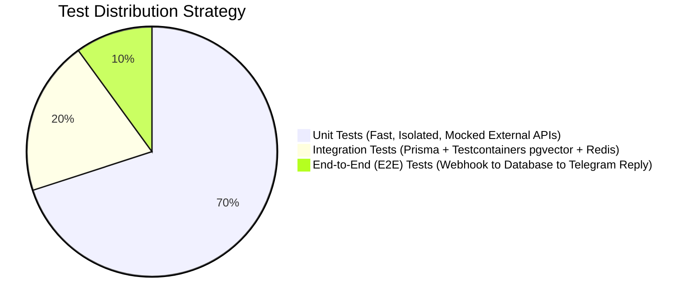

# TeleMind - Quality Assurance & Testing Strategy

| **Document Version** | 1.0.0 |
| **Minimum Coverage Target** | 85% Statements & Branches |
| **Status** | Active Standard |

---

## 1. Testing Pyramid & Strategy

TeleMind adheres to the classic Testing Pyramid. Fast unit tests form the broad foundation, backed by robust integration tests utilizing containerized dependencies, and targeted end-to-end (E2E) workflow tests.



---

## 2. Unit Testing

- **Scope**: Individual pure functions, chunking algorithms, Zod schema validation, DTO mapping, prompt assembling, and utility functions.
- **Tools**: Jest / Vitest with `ts-jest`.
- **Execution Speed**: Must execute entirely in memory within milliseconds.
- **Mocking**: External network services (Google Gemini API, Telegram Bot API) must always be mocked in unit tests:
  ```typescript
  describe('RecursiveTextChunker', () => {
    it('should split text into chunks within the maximum token limit', () => {
      const text = 'Sample enterprise document text...';
      const chunker = new RecursiveTextChunker({ maxTokens: 512, overlapTokens: 64 });
      const chunks = chunker.chunk(text);
      expect(chunks.length).toBeGreaterThan(0);
      expect(chunks[0].tokenCount).toBeLessThanOrEqual(512);
    });
  });
  ```

---

## 3. Integration Testing

- **Scope**: Prisma database queries, vector similarity search (`<=>`), Redis BullMQ queue producer/worker handoff, and NestJS module wiring.
- **Environment**: Powered by **Testcontainers** to spin up an ephemeral `pgvector/pgvector:pg16` and `redis:7-alpine` container per test suite.
- **Database Hygiene**: Every test suite runs database migrations automatically and truncates tables between tests to guarantee test isolation.

---

## 4. End-to-End (E2E) Testing

- **Scope**: Validates the full cycle from an incoming Telegram webhook update to BullMQ queue ingestion, RAG context retrieval, LLM synthesis, and Telegram reply dispatch.
- **Tooling**: Supertest against a running NestJS test application instance with wiremocked external HTTP gateways for Telegram and Gemini.

---

## 5. Coverage Goals & Quality Gates

| Component           | Minimum Line Coverage | Minimum Branch Coverage |
| ------------------- | --------------------- | ----------------------- |
| `packages/rag`      | 90%                   | 85%                     |
| `packages/ai`       | 90%                   | 85%                     |
| `packages/telegram` | 85%                   | 80%                     |
| `packages/database` | 85%                   | 80%                     |
| `packages/shared`   | 95%                   | 90%                     |
| `apps/api`          | 80%                   | 75%                     |
| `apps/worker`       | 80%                   | 75%                     |

### Enforcing Quality in CI

Pull requests fail automated checks if overall monorepo test coverage drops below 85% or if any single test fails.
